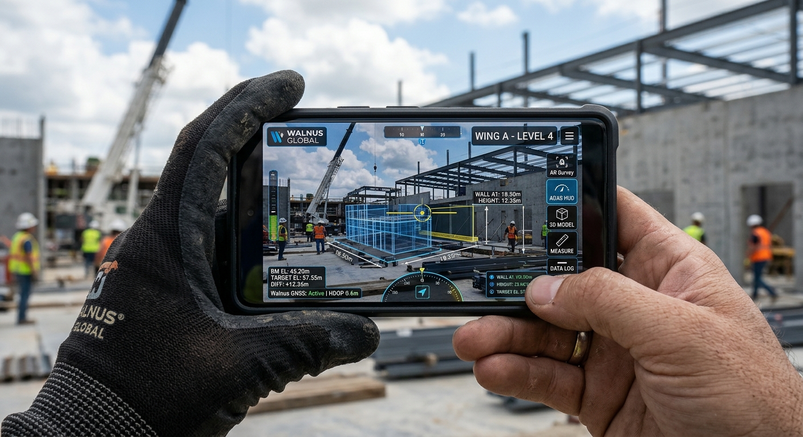

<p align="center">
  
</p>

<h1 align="center">SmartView Pro™</h1>
<p align="center">
  <b>Intelligent Construction Surveying, Spatial Measurement & Project-Intelligence Platform</b><br>
  <i>Developed by <b>Walnus Global Ventures</b></i>
</p>

<p align="center">
  <a href="#-project-overview">Overview</a> •
  <a href="#-key-features">Key Features</a> •
  <a href="#-system-architecture">Architecture</a> •
  <a href="#-technical-specifications">Tech Specs</a> •
  <a href="#-installation--getting-started">Installation</a> •
  <a href="#-contact--developers">Contact</a>
</p>

---

## 📱 Hero Showcase

<p align="center">
  
</p>

---

## 🔭 Project Overview

**SmartView Pro™** is a professional-grade, field-ready mobile and web intelligence platform designed for construction surveying, surface analysis, spatial measurement, and advanced material estimation. Powered by **Walnus Global Ventures**, SmartView Pro integrates high-precision camera capture, ADAS-inspired telemetry HUDs, offline-first local storage (IndexedDB via Dexie), and intelligent coating estimation for **SmartCoat™** materials.

Engineered for field engineers, quantity surveyors, and project managers, SmartView Pro ensures zero-latency offline operation in remote construction sites while delivering rigorous mathematical precision and enterprise-grade reporting.

---

## ⚡ Key Features

- **📷 Advanced Camera & AR Surveying:** Real-time camera feed integration with grid overlays, horizon levelers, GPS tracking, and spatial calibration.
- **🛸 ADAS-Inspired HUD Telemetry Matrix:** Live pitch/roll indicators, elevation profiles, HDOP coordinates, and structural integrity meters.
- **📐 Construction Geometry & Measurement:** Precise distance, perimeter, area, and volumetric calculations with measured vs. inferred data provenance tracking.
- **🎨 Surface Profiling & Coating Visualisation:** Interactive 3D/2D surface selection (raycasting, edge detection, manual polygon annotation) with custom color palette presets and primer/base coat/topcoat calculation.
- **🧮 SmartCoat™ Material Estimator:** Automated estimation for paint, plaster, and screeding with supplier pricing and instant quotation generation.
- **💾 Offline-First Architecture:** Local-first persistence using Dexie (IndexedDB) ensuring uninterrupted field operation without cellular connectivity.
- **📊 Comprehensive Reporting:** Instant PDF/CSV quotation and survey export with detailed material schedules and cost breakdowns.

---

## 🏗️ System Architecture

SmartView Pro is architected with strict adherence to modular separation of concerns:

```
src/
├── components/       # Reusable UI components & HUD widgets
├── db/               # Dexie offline-first database schemas & models
├── hooks/            # Custom React hooks (Camera, GPS, Spatial, Storage)
├── pages/            # Main application workspace views
│   ├── SurveyWorkspace.tsx
│   ├── ADASHUDView.tsx
│   ├── SurfaceVisualizer.tsx
│   ├── EstimatorView.tsx
│   └── ReportsView.tsx
├── services/         # Calculation engines & offline sync logic
└── types/            # TypeScript interfaces & domain types
```

---

## ⚙️ Technical Specifications

| Category | Specification |
| :--- | :--- |
| **Framework** | React 19 + TypeScript + Vite |
| **Styling** | Tailwind CSS v4 |
| **Storage** | Dexie v3 (IndexedDB) Offline-First Store |
| **Capture & Vision** | MediaDevices API / CameraX abstraction with HTML5 Canvas processing |
| **State Management** | React Hooks + Context API + Reactive Local Storage |
| **Testing & QA** | Vitest + TypeScript Strict Checks (`tsc --noEmit`) |

---

## 🚀 Installation & Getting Started

### Prerequisites
- **Node.js** >= 18.x
- **npm** or **bun**

### Local Development Setup

1. **Clone the repository:**
   ```bash
   git clone https://github.com/walnusglobal/smartview-pro.git
   cd smartview-pro
   ```

2. **Install dependencies:**
   ```bash
   npm install
   ```

3. **Run the development server:**
   ```bash
   npm run dev
   ```

4. **Build for production:**
   ```bash
   npm run build
   ```

---

## 🤝 Developer Contacts & Team

For technical inquiries, enterprise licensing, or partnership opportunities, please reach out to the core engineering team:

- **Primary Contact / Lead Architect:** [Sean Lawal](mailto:seanlawal@gmail.com)
- **LinkedIn:** [Oluwaseun Lawal](https://www.linkedin.com/oluwaseun-lawal)
- **GitHub Profile 1:** [@shawn-price](https://github.com/shawn-price/)
- **GitHub Profile 2:** [@cyberlawaltech](https://github.com/cyberlawaltech)

---

<p align="center">
  <i>© 2025–2026 Walnus Global Ventures. All rights reserved. Powered by SmartCoat™ AI-Driven Construction Intelligence.</i>
</p>
